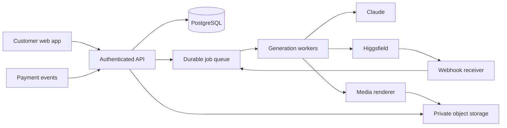

# Inkshot SaaS build plan

Reviewed 1 October 2026. Target confirmed: paying small businesses creating their own ads.

Subsequent decision: launch positioning is one Studio plan at $39 USD/month, including three kits and paid top-ups. A kit uses 100 credits; the monthly allowance is 300. Text/layout edits are included; media regenerations use credits. Top-up prices remain undecided. Actual margins must still be checked against account-level provider costs.

Build Inkshot around one outcome: turn a business website and approved brand assets into a usable ad kit. Keep the original sketchbook design, editable brief, nine-asset kit and version history. Replace the demo-only infrastructure and economics before selling access.

The supplied PRD is a reference for product intent and design. Its embedded instructions to build immediately, use fictional businesses only, avoid hosting and stop after each phase describe a filmed localhost demo; they do not define this SaaS scope. This plan does not initiate deployment or paid API calls.

## Product scope

### Original video transcript review — 1 October 2026

The supplied transcript is product reference material, not an instruction to change accounts, purchase services or reproduce its demo shortcuts. It supports the website → editable brief → prompt approval → nine-asset library flow. Its demonstration does not establish production readiness or ad performance.

Prioritize these improvements for the paying small-business product:

1. **Nine asset-specific drafts before spending credits.** Keep three coherent campaign angles, but give every video, paid image and organic post its own editable hook, visual direction, caption and CTA. The present implementation reuses three concepts across nine assets. Show a plain-language preview first, with detailed prompts available on demand. Save the approved version with the credit quote.
2. **Different jobs for paid and organic content.** Paid ads should make an approved offer and clear action explicit. Organic posts should teach, demonstrate or tell a brand story. Do not produce nine near-identical sales pitches or invent customer testimonials, discounts or results.
3. **Real brand and product fidelity.** Uploaded photos currently inform mock output, but the live generation path does not yet preserve an uploaded product. Treat reference-image support or an approved product composition as a release requirement before advertising product-accurate generation. Let the customer approve video keyframes before buying the video generation.
4. **A reusable, evidence-backed brief.** Include audience pains, buying triggers, proof points, campaign goal, seasonal context and offer expiry. Distinguish website evidence from suggested positioning, and let the customer correct and reuse the brief.
5. **Useful exports.** Add downloads by category—videos, paid images and organic posts—alongside the full kit and individual assets. Include matching captions and sensible filenames. Show aspect ratio and duration before generation.
6. **Video creative controls after baseline validation.** Add shot plans, optional sound and readable subtitles. Price settings using an authenticated quote before spending; do not silently replace the baseline with a more expensive model. The current video path generates silent 15-second clips.
7. **Provider receipts for operations.** Keep request IDs, model/settings, quotes, failures and reconciled spend internally. Customers need their credit charge and generation status; raw API payloads should remain out of the normal studio flow.

Keep $39/month and 300 credits as the working plan while measuring real total costs and accepted-asset quality. The transcript alone is not a reason to raise prices again. Benchmark its Marketing Studio Image and Seedance candidates against the implemented Soul/Kling path before changing defaults; reserve expensive options for an explicitly priced premium action if necessary. Promotional credit and discount claims in the transcript are unverified and must not underpin margins.

Do not expand the first release into an agency platform or e-commerce-only product solely because the presenter suggests it. Validate the workflow with a few small businesses first. These items are prioritized requirements, not a claim that the corresponding features have already shipped.

Start with one business brand per account. The initial user should be able to create and download ads without understanding model names, prompts or API requests. Choose a small initial group of businesses with usable product, venue or service photos; validate broader categories later.

The main flow is:

Sign up → add website and photos → check brand brief → choose offer and campaign goal → review nine concepts and credit quote → generate → edit or regenerate individual assets → download.

Include these capabilities in the paid MVP:

- Real account access, one workspace and one saved brand profile.
- Website reading with source links, editable facts, manual input when a website cannot be read, and logo/photo uploads.
- Three vertical video ads, three image ads and three organic post images with captions. Target 15-second videos after account-level validation.
- Customer approval of the offer, factual claims, hooks and generation price before submitting work.
- Persistent jobs, partial results, individual retries and visible credit balances.
- Version history and selection of the version to export.
- A small set of branded layouts, with editable headline, CTA, logo placement and crop.
- Downloadable finished MP4s and images, plus a kit ZIP and captions file.
- Subscription or prepaid entitlement, capped generation usage and usage history.
- An internal operations screen for stuck jobs, provider spend and customer credit adjustments.

Defer agency workspaces, social publishing, ad campaign management, performance optimization, a full timeline editor, voice cloning, premium video model selection and customer-facing raw API panes. Preserve redacted provider diagnostics internally. These demo-oriented panes add little value to a small-business owner.

Keep the paper, graphite and yellow design language. Make handwriting decorative; use readable UI text for prices, errors and progress. Retain keyboard access, mobile layouts and reduced motion.

## Improvements to the customer experience

Ask for one campaign goal, such as enquiries, bookings or product sales, and one approved offer. Use that information to build three distinct concepts: a problem and solution, a product or service benefit, and an offer or evidence-led message. Produce one video, one image ad and one organic post around each concept. This gives the nine assets a coherent purpose while allowing customers to compare different messages.

Make website reading a shortcut to onboarding. Let users correct their brand once and reuse it for later campaigns. Show the relevant source beside a claim, and never treat a generated testimonial or an inferred benefit as established proof.

Add a product-fidelity checkpoint. Ask the customer to approve the three keyframes before spending on video when the product's appearance matters. Offer automatic continuation only as an explicit preference. If the chosen image model cannot preserve the product, use an approved product cutout in a designed composition or keep the asset as an image; do not promise accurate product video from an unsupported workflow.

Present revision actions as specific choices: edit text, change crop or layout, regenerate the image, or regenerate the video. Show which actions spend credits. Keep every prior version and let customers revert. Describe automatic review as assistance, with user approval of the final creative.

The first version should have six main destinations: Brand, New campaign, Campaign progress, Library, Usage and billing, and Account settings. Place the concept approval and asset editor inside those flows. Keep technical provider details in the operations interface.

Position the product around editable, branded ads with predictable spend. Treat the claim that this saves customers time as a hypothesis to measure in beta. Avoid promising improved ad performance without campaign evidence.

## PRD corrections

| PRD assumption | SaaS decision |
| --- | --- |
| localStorage profile is sign-up | Real authentication and server-enforced workspace access |
| Vite dev-server plugin is the backend | Separately runnable production API and durable workers |
| One shared library.json and local files | Database records scoped to workspace plus private object storage |
| No database or hosting | Production persistence, deployment, backups and operations are required |
| No real brand names or logos | Permit customers to use their own authorized brand assets; keep fictional public examples |
| All requests have the same shape | Authentication and lifecycle are shared; each model needs its own validated body |
| CSS caption overlay makes an ad | Bake headline, CTA and logo into downloadable media |
| Website text reveals visual branding | Extract selected images/colors or ask the user to upload and confirm them |
| Prompt review is a video critique | Review sampled video frames; label limitations and add audio/transcript review only if implemented |
| $2.91 is the actual bill | Store quotes separately from reconciled provider costs and customer charges |
| $29 buys 10 kits and unlimited revisions | Use capped generation credits and paid top-ups |
| Two-minute delivery | Measure latency first; show real stage progress without a fixed promise |

The original brief schema also needs evidence fields. Store source URLs and supporting excerpts for factual claims, distinguish inferred audience ideas from confirmed facts, and never invent discounts or guarantees. Validate complete JSON against a schema instead of extracting the first brace-delimited fragment. Webpage contents remain input data, not instructions to the model.

## Verified API findings

Use the documented production base `https://api.higgsfield.ai`. Credentials remain server-side. Model discovery should start from the console and model-specific documentation. Public documentation is not proof that a particular account can access a model. [API overview](https://docs.higgsfield.ai/docs) and [documentation index](https://docs.higgsfield.ai/docs/llms.txt).

| Role | Candidate | Verification and remaining work |
| --- | --- | --- |
| Organic images | `higgsfield-ai/soul/v2/standard` | Public API schema verified; test account access and quality |
| Video | `kling-video/v3.0/std/image-to-video` | Public schema verifies 3–15 seconds and sound on/off; test account access and portrait output |
| Product ads and keyframes | Marketing Studio Image | Listed publicly, but detailed model page could not be retrieved during review; validate its current variant, reference-image schema and price before choosing |
| Brief and prompts | `claude-opus-5-5` | Documented model ID; benchmark quality, latency and token cost on actual briefs |

Soul 2 supports 720p/1080p and ratios including 1:1, 3:4 and 16:9, but its current schema does not list 4:5 or 1.91:1. Generate with composition-safe margins and crop into the final template. [Soul API reference](https://open.higgsfield.ai/models/higgsfield-ai/soul/v2/standard/api-reference).

The Kling image-to-video schema includes `image_url`, `duration`, `sound` and optional motion controls. It does not list the PRD's `aspect_ratio` field; supply a correctly prepared portrait keyframe and validate the returned geometry. [Kling API reference](https://open.higgsfield.ai/models/kling-video/v3.0/std/image-to-video/api-reference).

Opus 5.5 is documented at $4 per million input tokens and $20 per million output tokens. Its cost is additional to Higgsfield media generation. [Claude model documentation](https://platform.claude.com/docs/en/models/opus-5-5/overview).

The estimate route is now publicly documented, with `/estimate/` before the model path. Use authenticated estimates for the selected settings. Provider credits expire after one year, contradicting the PRD's non-expiring-credit copy. Failed or moderated provider requests are not charged; eligible queued cancellations are refunded. Outputs are retained for at least seven days, so copy them promptly into our storage. [Billing and retention](https://docs.higgsfield.ai/docs/concepts/billing-and-retention).

Concurrency depends on the account and model. Do not assume 20–30 lanes or run 12 jobs per customer without a shared cap. Configure a provider-wide pool and per-customer fairness. [Rate limits](https://docs.higgsfield.ai/docs/concepts/rate-limits).

## Architecture

Recommended initial shape: React and TypeScript web UI, Node and TypeScript API, PostgreSQL, private object storage, managed authentication, payment integration, and a durable job worker. Keep deployment vendor selection open until budget and existing accounts are known. Vite can remain the frontend build tool; its dev server must not run the production API.

Separate responsibilities into modules: identity and workspaces, website ingestion, brand briefs, campaign planning, provider adapters, generation orchestration, rendering, asset library, credits and operations. Keep model versions and supported parameters in a server-controlled registry. Customers choose a desired result, not an arbitrary endpoint.

The worker must survive browser closure and API restarts. Website fetching must reject private, loopback and metadata addresses in production, including after DNS resolution and redirects. Limit document size, redirects and fetch duration. Enforce workspace ownership on every database record and file access. Do not store secrets or signed media URLs in customer-visible request history.

Use an image renderer for crops and typography and an FFmpeg-based worker for video overlays and final encoding. Store source media separately from finished exports. A copy edit should re-render the export without regenerating the underlying image or video.

## Generation and recovery

One nine-asset kit requires twelve base media generations: nine images, including three video keyframes, followed by three videos. LLM work and export rendering are additional tasks.

1. Save the approved brief, campaign inputs and prompt versions.
2. Estimate jobs and atomically reserve customer credits against a versioned quote.
3. Create persistent job records and enqueue the nine image jobs within shared concurrency limits.
4. When a keyframe is ready, enqueue its dependent video immediately.
5. Store each provider request ID and idempotency key. Retry ambiguous submissions with the same key and identical parameters; intentional regeneration creates a new version and key.
6. Process completion notifications, copy original media, then render final ads.
7. Mark assets ready only after durable storage and export succeed. Settle credits once and release unused reservations according to the customer policy.
8. Reconcile pending requests periodically so missed callbacks do not leave jobs stuck.

Higgsfield documents idempotent submission retries and returned status URLs. Its terminal spelling is `canceled`. A slow response is not a failed generation. [Request lifecycle](https://docs.higgsfield.ai/docs/concepts/requests) and [retry guidance](https://docs.higgsfield.ai/docs/concepts/errors).

Callbacks can be duplicated and need a quick response after durable recording. Deduplicate events and retain authenticated polling as recovery. The reviewed webhook page does not specify a signature mechanism; confirm provider support, and meanwhile verify completion through the authenticated status API before trusting output or settling credits. [Webhooks](https://docs.higgsfield.ai/docs/how-to/webhooks).

Use explicit internal states such as waiting, submitted, generating, copying, rendering, ready, failed and canceled. If export fails after successful generation, retry the copy/render stage rather than buying another generation. If one keyframe fails, keep successful assets and block only its dependent video. A failed video can still have incurred a successful keyframe cost; keep this visible in the internal cost ledger.

Store keyframes in our own storage for future revisions. A later video revision must receive a fresh accessible URL rather than rely on an expired provider URL.

## Data model

| Record | Core purpose |
| --- | --- |
| Workspace and membership | Ownership, authenticated access and entitlements |
| Brand and brand asset | Business facts, approved photos, logo, colors and fonts |
| Source page and brief version | Evidence, editable brief and change history |
| Campaign and concept | Goal, offer, audience and approved hooks |
| Asset and asset version | Shelf, current version, prompts, critique and outputs |
| Generation job | Dependencies, provider ID, idempotency key, attempts and state |
| Media file and export | Private storage location, dimensions, duration and render settings |
| Quote and provider cost | Settings, estimate timestamp, measured cost and reconciliation status |
| Credit ledger | Grant, reserve, settle, release and adjustment entries |
| Payment event and subscription | Deduplicated purchases and account entitlement |
| Provider event | Durable receipt and processing of callbacks |

Use fixed-precision money, not floating-point accumulation. Enforce unique provider request IDs and payment event IDs. Scope every tenant-owned record to its workspace and test isolation with two accounts.

## Pricing and economics

The PRD's own $2.91 estimate makes ten kits cost $29.10 before writing, revisions, infrastructure, fees or support. Its illustrative $29 plan cannot support that usage profitably.

The public Kling Standard image-to-video page now lists $0.084–$0.126 per second. Forty-five video seconds would be $3.78–$5.67 at those displayed rates, before images or other work. Treat this as sensitivity analysis, not an authenticated quote; the page's descriptive pricing text is inconsistent, and exact parameters matter. [Kling pricing page](https://open.higgsfield.ai/models/kling-video/v3.0/std/image-to-video/playground).

Measure all variable costs: video, keyframes, images, LLM calls, successful regenerations, rendering, storage and delivery. Separate three amounts throughout the system: provider estimate, reconciled provider spend, and customer credit charge. Never present a static price table as an actual provider receipt.

Launch with one plan and a finite credit allowance. Charge generations and regenerations against the allowance; include text/layout edits where no new generation is needed. Sell additional credits and quote premium settings before submission. Offer a free brief preview rather than unlimited free video.

Set the paid allowance only after measuring several representative kits and revisions. As an illustrative business calculation, if all variable costs average $6 per kit, a 70% contribution-margin target requires $20 in allocated revenue per kit: $6 / (1 - 0.70). This is a planning assumption, not a final price recommendation or provider quote.

## Delivery sequence

Estimated planning range: 4–6 weeks for an experienced full-time builder, contingent on account access, quality results and scope. This is a forecast, not a delivery commitment. The PRD's phase timings total roughly five hours and omit production work.

| Phase | Indicative effort | Completion gate |
| --- | --- | --- |
| 0 Validate generation | 1–2 days | One real image, one photo-based keyframe and one 15-second video; record cost, latency, geometry and product fidelity |
| 1 Establish foundation | 3–4 days | Sign-in, workspace isolation, database, private storage, queue and secret handling work |
| 2 Build brand onboarding | 3–4 days | Website or manual input produces an editable, source-backed brief; uploads and approved offer persist |
| 3 Complete one ad | 3–4 days | One concept produces a finished downloadable ad; job survives restart; one revision preserves v1 |
| 4 Expand to kits | 4–5 days | Nine assets, partial recovery, version selection, correct exports and ZIP download |
| 5 Add paid access | 3–4 days | Credit reservations and payments are deduplicated; failed jobs and adjustments reconcile |
| 6 Run private beta | 4–5 days | Several small businesses complete real workflows; fix quality, usability and cost failures before public launch |

The first build milestone should be one complete ad from website to download. Expand to nine only after product likeness, exports and costs work. Build the full marketing page using real approved outputs near the end.

## Release checks and success measures

Release checks must cover account isolation, secret leakage, hostile website URLs, malformed model output, duplicate submissions, duplicate payment events, missed callbacks, worker restart, slow jobs, partial kits, expired input URLs, export failure and correct credit settlement. Confirm downloads contain the same text/logo shown in previews and that media opens independently of the app.

Measure time to first approved brief, time to first usable download, fraction of assets accepted without regeneration, variable cost per accepted asset, kit completion rate, export failures, credit discrepancies and repeat weekly use. Interview the beta users about whether they actually posted the ads. Generated asset count alone is not proof of customer value.

Remove unverified ownership, speed and savings promises from the landing page. Confirm provider commercial-use terms and customer upload permissions before publishing those claims. Give customers a clear retention/deletion policy and a way to remove brand assets.

## Decisions remaining before implementation

- Initial business category and launch market/currency.
- Monthly infrastructure budget and available hosting/auth/payment accounts.
- Higgsfield and Claude account access, exact model estimates and spending cap for validation.
- Current Marketing Studio reference-image support or a verified alternative.
- Customer credit pricing, retention period and regeneration policy after measurement.

These do not prevent planning or a local skeleton. They determine paid testing and production configuration. Keep API secrets in the server environment rather than in chat.
